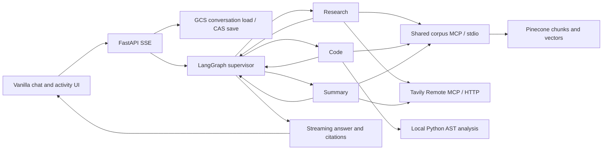

# Architecture

## Supervisor graph

The supervisor is an actual LangGraph node with conditional worker edges. It sees task, history, findings, errors, and completed workers. Workers return findings to the supervisor rather than following an unconditional pipeline. Explicit task requirements are checked against completed state: a request to research then summarize must finish both tasks in order, even if the planner proposes finishing early. Research must successfully retrieve corpus evidence, or Tavily evidence for current/web requests, before returning a finding. Code must inspect the code and retrieve documentation; Summary must read explicitly selected sources. Failed tool calls do not satisfy these requirements. Each has a unique prompt and a tool allowlist defined in `app/tools.py`.

Graph state contains query/code/selected sources, bounded conversation context, findings, errors, dispatch count, completed workers, next node, provider, rationale, and answer. Maximum six worker dispatches, four tools per invocation, and graph recursion limit 20. Workers fail into structured error state, not a graph-wide crash. The final answer can describe limited evidence.

## Agent tools

| Node | Responsibility | Available tools |
|---|---|---|
| Supervisor | Choose the next task and generation provider from shared state | No retrieval tools; validated routing output |
| Research | Retrieve corpus evidence and current web sources | Corpus `search_corpus`, `read_chunks`; Tavily search/extract |
| Code | Inspect supplied Python and consult documentation | Corpus `search_corpus`, `read_chunks`; local `analyze_python` |
| Summary | Summarize selected sources or existing findings | Corpus `read_chunks`, `read_document`; Tavily extract |
| Answer | Stream the response using findings and source evidence | No tools |

## Provider routing

The Supervisor uses OpenAI `gpt-6-luna` with reasoning `none` to choose a worker and generation provider. NVIDIA handles simple lookups, short summaries, and simple follow-ups. OpenAI `gpt-6.1-sol` handles multi-source synthesis, complex Python analysis, and difficult contextual follow-ups. Distinct workers may use either model. The supervisor returns validated `next`, `provider`, and `reason` fields; those drive transitions and are visible in traces. Routing remains subject to model classification quality and is measured through behavioral scenarios.

| Condition | Model/provider | Routing dimension |
|---|---|---|
| Every Supervisor plan | OpenAI `gpt-6-luna`, reasoning `none` | Focused structured classification |
| Straightforward worker lookup, short summary, simple follow-up | NVIDIA `nvidia/nemotron-3.5-lightning-30b-a3b` | Cost/access and capability |
| Complex comparison, architecture, debugging, or contextual synthesis | OpenAI `gpt-6.1-sol`, reasoning `low` | Capability; visible policy signals can override the plan |
| NVIDIA request fails | OpenAI Sol for remaining worker/answer calls | One-way reliability fallback; Supervisor stays Luna |

All provider calls pass through the same adapter. NVIDIA transient failure gets one bounded retry, then OpenAI; permanent errors skip retry. A fallback pins the remainder of the turn to OpenAI. A reset event clears visible partial text before regeneration. Tool results from completed steps remain in context. OpenAI transient calls retry once, never switch back to NVIDIA, and propagate a structured failure if exhausted. Cancellation is not failure. Individual model calls have connect 10s/read inactivity 30s timeouts; the complete turn has a 275s deadline.

Provider adapters use OpenAI Responses and NVIDIA's OpenAI-compatible Chat Completions. Tool choices are schema-validated JSON actions containing tool names/arguments; the app executes actual MCP calls and supplies results back to the worker. Native function calling is not required for this action loop.

## Retrieval and source boundaries

The 52-entry official-document manifest is normalized into substantive source snapshots. Chunking targets 750 tokens with 100-token overlap, preserving ordinary code blocks. Oversized blocks are bounded. Deterministic IDs combine URL-derived document ID and chunk ordinal. Each record contains text, topic, title, URL, heading, snapshot date/hash, and corpus version. Versioned namespaces isolate re-indexing.

OpenAI small embeddings use 1536 dimensions. Pinecone uses cosine similarity and a `kind=chunk` filter; exact manifest records are excluded. Default retrieval k=5, bounded to 10. Corpus MCP executes an LCEL embedding → vector-retrieval sequence. After the agent-selected retrieval/read tools return evidence, another LCEL sequence formats each chunk as `[id] title / heading` followed by its text, then invokes streamed answer generation. The MCP boundary lets workers select and share retrieval rather than forcing every turn through a fixed search. This is not keyword search. Read tools fetch exact records, with document manifests reconstructing the first 20 ordered chunks.

Citation IDs travel from tools through worker findings to final prompts. The final SSE event includes only cited IDs present in the tool source registry. Answers based on retrieved findings must contain a verifiable citation; invalid outputs are retried through the provider adapter with citation-specific repair instructions. Unambiguous padded ordinals and parent-document references are normalized to retrieved chunk IDs. Unknown corpus-shaped IDs in text are replaced with a source-unavailable marker. Clicking sources displays the excerpt and original HTTP(S) URL. Web sources use URL-derived IDs and are stored with the conversation for display after refresh.

## MCP sharing

The corpus server is a Python stdio subprocess inside the container, discovered with MCP `tools/list` and invoked with `tools/call`. Its required OpenAI and Pinecone settings are explicitly forwarded because MCP's default child environment does not inherit arbitrary credentials. Research and Code share the same `search_corpus` tool for different tasks. Summary gets exact source reading. Tavily uses hosted Streamable HTTP with query-parameter authentication and provides Research search/extract and Summary extract. Discovery and tool events are traced. Shared-tool credit requires observed calls from both workers, not just configured access.

## Durable state

GCS is conversation storage only; it is not the vector store or a mounted SQLite database. The backend loads each session object with a generation-pinned read and writes with `if_generation_match`. Concurrent writers cannot silently replace each other's completed turn. On conflict the unsaved turn returns an error. The UI serializes sends but backend CAS also covers multiple tabs/instances.

Retain 30 completed turns, 60 messages, and compact trace summaries. Model context contains recent 12 messages and a bounded selection of earlier worker findings. Older context is not guaranteed to be fully available. The durability claim is completed turns across replacement, not mid-graph checkpoint resume. Local storage is explicitly development-only. Cloud Run rejects local storage mode.

## SSE and deployment

The POST stream carries ordered typed events for routing, agent lifecycle, tool calls, fallback, answer reset/deltas, citations, metrics, errors, and done. Heartbeats keep the client informed during retrieval. Successful completion follows durable save; errors never claim a save. Disconnect cancels work without provider fallback.

FastAPI serves static assets and five application routes. A non-root Python container deploys on Cloud Run with injected PORT, min 0/max 2 instances, concurrency 5, and 300s request timeout. Only the app is public; the GCS bucket and service credentials are private. Credentials come from Secret Manager with service-scoped IAM. Public conversation IDs are bearer capabilities, not user authentication; the demo is not intended for confidential data.

Trace explanations are short operational decisions, not private chain-of-thought. Model metrics record all attempts, known usage, latency, and partial cost estimates. Local and Cloud Run timing are reported separately.
